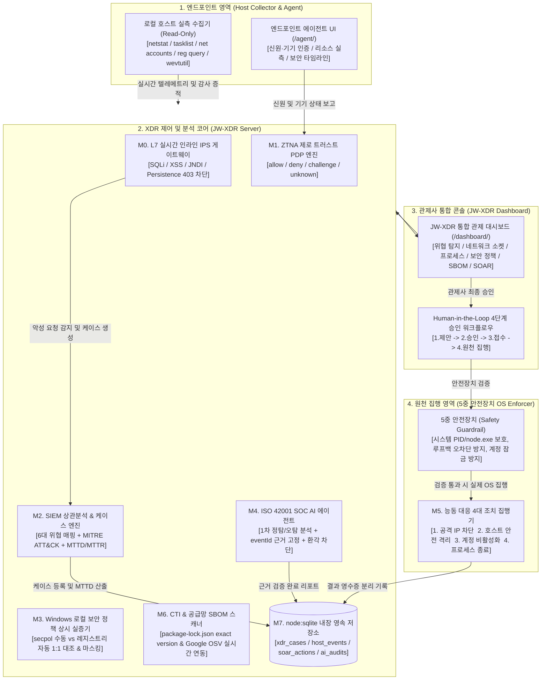
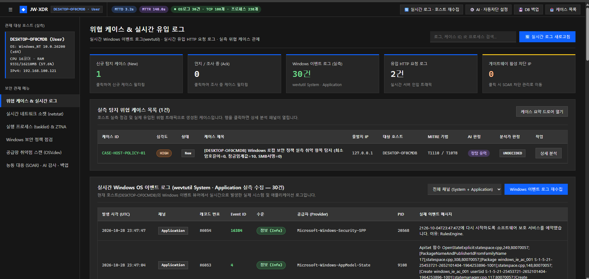
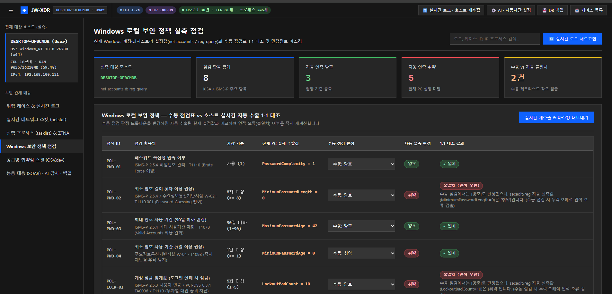
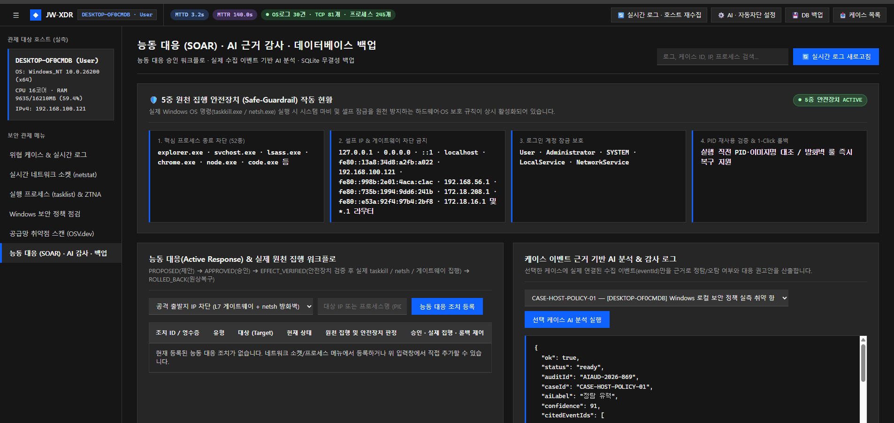

# JW-XDR — 로컬 호스트 실시간 통합 보안 관제 및 능동 대응(SOAR) 플랫폼

> "본 시스템은 SKT ALEPH 교육 과정 커리큘럼에 따라 개발된 로컬 호스트 실시간 통합 보안 관제 및 능동 대응(SOAR) 플랫폼(JW-XDR)입니다. 1) 제로 트러스트 접근 제어(ZTNA), 2) SIEM/XDR 실시간 로그 상관분석 및 MITRE ATT&CK 매핑, 3) Windows 로컬 보안 정책 수동/자동 상시 실증, 4) ISO 42001 기반 SOC AI 에이전트 1차 정탐/오탐 분석, 5) 5중 안전장치 기반 Human-in-the-Loop 능동 대응(Active Response 4대 조치)을 통합 구현하였습니다."

---

## 1. 프로젝트 개요 및 핵심 설계 원칙

JW-XDR은 더미 데이터나 단순 시뮬레이션에 의존하지 않고, 현재 구동 중인 로컬 Windows 호스트(os.hostname())의 실제 상태를 직접 실측, 관제, 집행하는 독립형 XDR & SOAR 플랫폼입니다.

- **실제 호스트 실측**: `netstat.exe -ano`, `tasklist.exe`, `net accounts`, `reg.exe query`, `wevtutil.exe`를 읽기 전용(Read-Only)으로 실시간 파싱하여 활성 소켓, 실행 프로세스, 로컬 보안 정책을 100% 실측합니다.
- **L7 인라인 침입 방지 (IPS)**: 서버(5280 포트)로 인입되는 모든 HTTP 요청을 실시간 검사하여 SQLi, XSS, JNDI/Log4Shell, 레지스트리 영속성 변조, 권한상승 시도를 HTTP 403 Forbidden으로 즉각 인라인 차단하고 케이스를 자동 발행합니다.
- **제로 트러스트 접근 제어 (ZTNA PDP)**: 신원(Identity), 기기 등록(Device), 상황 맥락(Context)을 3단 분리 평가하여 allow, deny, challenge, unknown 4상태로 판정합니다. (원천 신호 부재 시 무조건 unknown으로 처리하여 보안 구멍을 차단)
- **ISO 42001 근거 고정 SOC AI 트리아지**: AI 모델이 실제 수집된 eventId만 인용하도록 고정(Evidence Binding)하여 환각(Hallucination) 및 사전 임의 차단 월권(Overreach)을 가드레일로 원천 차단합니다.
- **5중 안전장치 기반 원천 집행 (SOAR)**: 커널/시스템 프로세스(explorer.exe, node.exe 등) 종료 방지, 루프백/로컬 NIC 오차단 방지 등 5중 안전장치를 통과한 건만 집행하며, 4단계 승인 게이지(제안 -> 승인 -> 접수 -> 원천 집행)와 1-Click 롤백을 보장합니다.
- **순수 네이티브 경량 스택**: 외부 무거운 프레임워크나 서드파티 바이너리 없이 Node.js (>=22.5.0) 내장 `node:sqlite` 및 순수 Vanilla ES Modules로만 구현되어 즉시 실행됩니다.

---

## 2. 시스템 아키텍처



---

## 3. 대시보드(/dashboard/) 6대 핵심 관제 메뉴

### 3.1 실제 구동 화면

| 대시보드 메인 관제 화면 | Windows 보안 정책 상시 실증 | 능동 대응(SOAR) 및 AI 감사 |
| :---: | :---: | :---: |
|  |  |  |

### 3.2 6대 관제 메뉴 상세 규격

| 메뉴명 | 주요 기능 및 실측 원리 | 관련 모듈 |
| :--- | :--- | :--- |
| **1. 위협 탐지 및 케이스 관제 (`cases`)** | - L7 인라인 IPS 실시간 패킷 검사 (SQLi, XSS, JNDI, 레지스트리 변조 감지 시 즉시 403 차단 및 케이스 생성)<br>- MITRE ATT&CK 14단계 공격 단계(Kill Chain) 하이라이트 및 엔터티 관계 그래프<br>- 정탐/오탐 판정 및 룰 튜닝, 사건 탐지/대응 시간(MTTD / MTTR) 실시간 메트릭 산출 | `server.mjs`<br>`detect-engine.mjs`<br>`case-manager.mjs` |
| **2. 실시간 네트워크 소켓 (`network`)** | - `netstat.exe -ano -p TCP`를 실시간 호출하여 활성 연결(ESTABLISHED), 대기(LISTENING), 외부 원격 IP 실측<br>- 프로세스 테이블과 PID 자동 매핑을 통해 외부와 통신 중인 프로세스 실시간 식별<br>- 이상 IP 발견 시 [IP 차단 제안] 원클릭 SOAR 티켓 등록 | `live-host-collector.mjs`<br>`active-response.mjs` |
| **3. 실행 프로세스 및 ZTNA (`endpoint`)** | - `tasklist.exe /FO CSV /NH` 호출을 통해 현재 PC의 모든 프로세스 목록과 메모리 점유율(MB) 실시간 조회<br>- CPU 코어 수, RAM 실시간 사용률, 활성 IPv4 네트워크 어댑터 및 MAC 주소 하드웨어 실측<br>- ZTNA 3단 평가(신원, 기기, 맥락) 기반 4상태(allow / deny / challenge / unknown) 즉시 판정 | `live-host-collector.mjs`<br>`decider.mjs` |
| **4. Windows 보안 정책 실측 (`policy`)** | - `net accounts` 및 `reg.exe query` (Lsa, LanmanServer, RDP-Tcp)를 호출하여 실제 암호 길이, 잠금 임계값, NLA 설정값 파싱<br>- 관리자의 수동 체크리스트와 1:1 비교를 수행하여 인적 오류(불일치) 즉시 검출<br>- 진단 데이터 내보내기 시 API 키, 세션 토큰 등 개인정보 및 비밀값을 [REDACTED]로 자동 마스킹 | `win-policy-parser.mjs`<br>`live-host-collector.mjs` |
| **5. 공급망 취약점 스캔 (`sbom`)** | - 실제 `package-lock.json`에서 의존성 패키지와 정확한 버전(exact_lock_version) 추출<br>- Google OSV API (https://api.osv.dev/v1/querybatch) 실시간 통신을 통해 vulnerable / none_found / unverifiable 3상태 분류<br>- 통신 장애 시 취약점 없음으로 오판하지 않고 정직하게 unverifiable로 분리하는 Fail-Safe 실증 | `sbom-osv-scanner.mjs` |
| **6. 능동 대응(SOAR), AI 감사, DB 백업 (`soar`)** | - 4대 능동 대응 조치: 공격 IP 차단, 호스트 격리, 계정 비활성화, 악성 프로세스 강제 종료<br>- Human-in-the-Loop 4단계 승인 게이지: 제안(Proposed) -> 승인(Approved) -> 접수(Pending ACK) -> 원천 집행(Effect Verified)<br>- ISO 42001 근거 고정 AI 분석: 가짜 eventId 환각 차단 및 AI 임의 집행 월권 거부 실증<br>- SQLite 헤더 무결성 백업: SQLite format 3 16바이트 검증 백업 및 변조 파일 복원 거부 | `active-response.mjs`<br>`os-enforcer.mjs`<br>`soc-triage-agent.mjs`<br>`sqlite-store.mjs` |

---

## 4. 5중 안전장치 (Safety Guardrails)

원천 집행(SOAR) 시 오작동으로 인한 시스템 중단 및 관리자 작업 단절을 막기 위해 5중 안전장치가 강제됩니다:

1. **보호 프로세스 강제종료 차단 (`KILL_MALICIOUS_PROCESS`)**:
   - Windows OS 필수 시스템 프로세스(csrss.exe, lsass.exe, svchost.exe, explorer.exe 등) 및 현재 작업 환경 프로세스(node.exe, code.exe, chrome.exe, powershell.exe 등), 시스템 PID(<= 100), 현재 XDR 서버 PID(process.pid) 종료 시도를 원천 차단합니다.
   - 실행 직전 tasklist로 PID와 이미지명을 재검증하여 PID 재사용(Race Condition)으로 인한 오종료를 방지합니다.
2. **보호 IP 차단 방지 (`BLOCK_ATTACK_IP`)**:
   - 루프백 주소(127.0.0.1, localhost, ::1), 현재 호스트의 실제 NIC IPv4 주소, 기본 게이트웨이(*.1)의 차단을 원천 방지합니다.
3. **보호 계정 잠금 방지 (`DISABLE_OS_ACCOUNT`)**:
   - 현재 로그인된 사용자 계정(os.userInfo().username), 기본 Administrator, 시스템 계정의 잠금을 차단합니다.
4. **호스트 보호 격리 (`ISOLATE_HOST`)**:
   - 물리 랜카드를 강제 비활성화하여 관제 화면까지 먹통이 되는 사고를 방지하고, 루프백 관제 통신은 유지한 채 외부 인입 트래픽만 차단하는 안전 보호 격리를 적용합니다.
5. **정직한 원천 집행 분리 (Honest State Separation)**:
   - 원천 집행기 미연동 상태에서 집행 성공으로 거짓 보고하는 행위를 엄격히 차단하며, 영수증 발급 후 PENDING_ACK 상태로 정직하게 기록합니다.

---

## 5. 프로젝트 디렉토리 구조

```plaintext
JW-XDR/
├── 스크린샷/                       # 실제 시스템 구동 화면 캡처 이미지
│   ├── 대시보드.png
│   ├── window보안정책점검.png
│   └── soar등.png
├── src/
│   ├── server.mjs                  # 통합 HTTP 웹 서버 & L7 인라인 IPS 게이트웨이
│   ├── ztna/
│   │   └── decider.mjs             # ZTNA 3단 평가 & 4상태(allow/deny/challenge/unknown) 판정
│   ├── xdr/
│   │   ├── detect-engine.mjs       # 6대 위협 시나리오 × MITRE ATT&CK 룰 탐지 엔진
│   │   ├── case-manager.mjs        # 사건 인제스트, 상관분석, 판정 튜닝 및 MTTD/MTTR 산출
│   │   ├── live-host-collector.mjs # netstat / tasklist / net accounts / wevtutil 실측 수집기
│   │   └── win-policy-parser.mjs   # Windows 로컬 보안 정책 1:1 대조 및 [REDACTED] 마스킹
│   ├── soar/
│   │   ├── active-response.mjs     # 4대 능동 대응 및 Human-in-the-Loop 4단계 승인 워크플로우
│   │   └── os-enforcer.mjs         # 5중 안전장치(Guardrail) 검증 및 실제 OS 원천 집행기 (taskkill/netsh)
│   ├── ai/
│   │   ├── ai-gateway.mjs          # LLM 게이트웨이 헬스체크 및 7종 장애 복구 가이드
│   │   └── soc-triage-agent.mjs    # ISO 42001 근거 고정(Evidence Binding) SOC AI 분석 에이전트
│   ├── cti/
│   │   └── sbom-osv-scanner.mjs    # package-lock.json exact version & Google OSV API 배치 쿼리
│   └── db/
│       ├── schema.sql              # node:sqlite DDL 테이블 정의 (cases, events, soar, audits)
│       └── sqlite-store.mjs        # SQLite 영속 저장소, 헤더 무결성 백업 및 복원 방어
├── public/
│   ├── dashboard/                  # JW-XDR 통합 관제 대시보드 SPA (HTML, CSS, Vanilla MJS)
│   └── agent/                      # JW-XDR 엔드포인트 보안 에이전트 UI (HTML, CSS, Vanilla MJS)
├── scripts/
│   └── windows-policy-audit.bat    # Windows 보안 정책 자동 추출 감사 배치 스크립트
├── test/
│   ├── self-verification.mjs      # M1 ~ M8 단위 보안 게이트 자동 검증 스위트
│   └── e2e-live-test.mjs           # 실서버 포트 바인딩 및 REST API 라이브 통합 E2E 테스트 스위트
├── data/                           # SQLite 데이터베이스 저장소 (jw_xdr.db - Git 추적 제외)
├── backup/                         # SQLite 무결성 백업 아카이브 (Git 추적 제외)
├── package.json                    # 프로젝트 메타데이터 및 실행 스크립트 정의
├── run-jw-xdr.bat                  # Windows 환경 원클릭 실행 배치 스크립트
└── README.md                       # 프로젝트 종합 안내 문서
```

---

## 6. 빠른 시작 및 검증 방법

### 6.1 요구 사양
- **OS**: Windows 10 또는 Windows 11 (호스트 실측 및 Windows 보안 정책 감사용)
- **Runtime**: Node.js >= 22.5.0 (`node:sqlite` 내장 지원 필수)
- **별도 npm 패키지 설치 불필요**: Node.js 표준 라이브러리만 사용하므로 `npm install` 과정 없이 바로 구동 가능합니다.

### 6.2 실행 명령어

```powershell
# 1. 서버 구동 (기본 포트: 5280)
npm start

# 또는 Windows 탐색기에서 run-jw-xdr.bat 더블 클릭 실행
```

### 6.3 접속 주소
- **통합 관제 대시보드**: http://127.0.0.1:5280/dashboard/
- **엔드포인트 에이전트 UI**: http://127.0.0.1:5280/agent/

---

## 7. 테스트 및 검증 스위트

전체 시스템의 무결성을 완벽하게 보장하기 위해 3단계 검증 파이프라인을 지원합니다:

```powershell
# 전체 검증 일괄 실행 (문법 체크 + 보안 게이트 단위 테스트 + 실서버 E2E 테스트)
npm run test:all
```

### 세부 검증 단계:
1. **ES Module 문법 무결성 검증**:
   ```powershell
   npm run check
   ```
2. **M1 ~ M8 보안 게이트 단위 검증**:
   ```powershell
   npm test
   ```
   - ZTNA 4상태 판정
   - MITRE ATT&CK 6대 위협 매핑 및 MTTD/MTTR 산출
   - Windows 정책 1:1 대조 및 [REDACTED] 마스킹
   - ISO 42001 AI 근거 고정(eventId) 및 환각 차단
   - SOAR 인간 승인 4단계 전이 및 원천 집행 미연동 정직 분리
   - package-lock.json exact version & OSV 3상태 분류
   - SQLite 16바이트 헤더 무결성 백업 및 변조 파일 복원 거부
   - CSP(style-src 'self') 인라인 style 속성 제로(Zero) 검증
3. **실서버 라이브 E2E 기능 구동 테스트 (14/14 통과)**:
   ```powershell
   npm run test:e2e
   ```
   - 실제 HTTP 서버 포트 바인딩 및 302 라우팅
   - L7 인라인 IPS 실시간 SQLi 차단 및 악성 IP 게이트웨이 즉시 드롭
   - 호스트 프로세스 및 활성 소켓 실측 텔레메트리
   - SOAR 5중 안전장치(보호 프로세스 종료 방어) 실증

---

## 8. 라이선스

본 프로젝트는 MIT License에 따라 자유롭게 사용, 수정, 배포할 수 있습니다.
